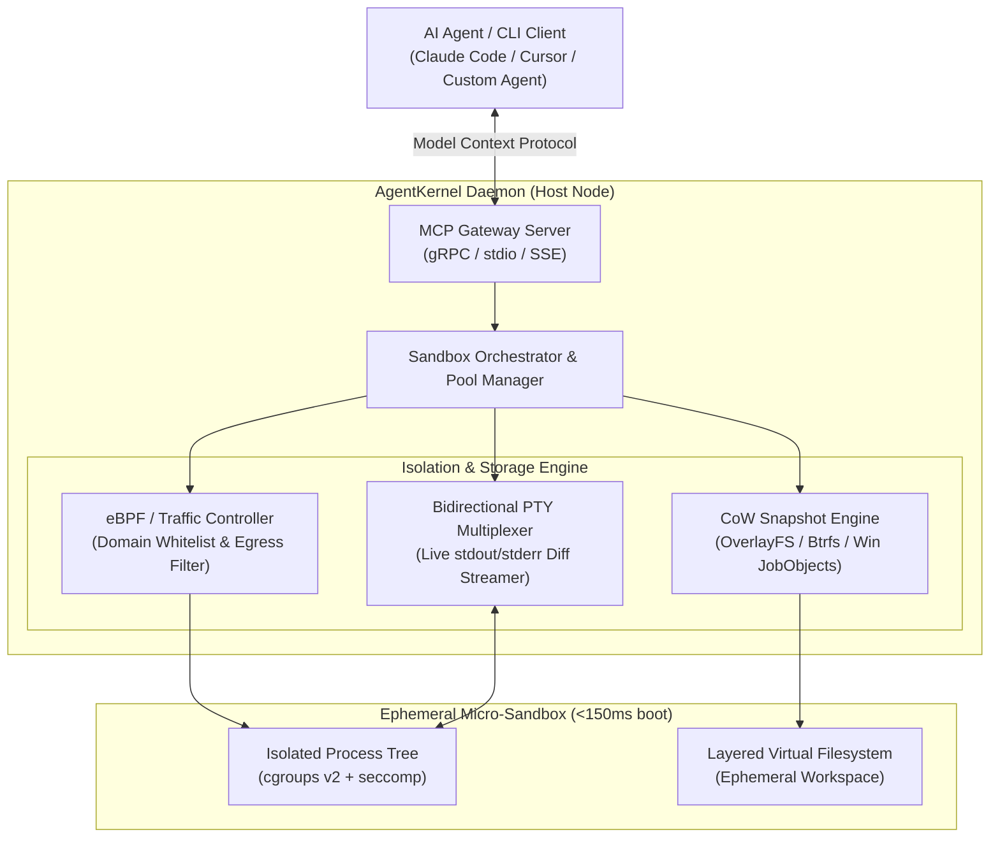

# 🛡️ AgentKernel

> **High-Performance Ephemeral Micro-Sandbox Runtime & Native Model Context Protocol (MCP) Server for Autonomous AI Coding Agents.**

[-orange.svg)](#mcp-integration)

---

## 📌 Executive Summary

Современные автономные AI-агенты (Cursor, Claude Code, Devin, AutoGen) сталкиваются с фундаментальной инфраструктурной проблемой:
1. **Запуск сгенерированного кода локально** смертельно опасен для хост-системы (случайный `rm -rf`, перезапись `.env`, переполнение диска).
2. **Запуск в традиционном Docker** слишком медленный (cold boot от 2 до 5 секунд) и потребляет гигабайты памяти на контейнер.
3. **Облачные песочницы (E2B, Modal)** стоят дорого, имеют задержку по сети и не подходят для enterprise-компаний из-за утечки исходного кода в публичные облака.

**AgentKernel** — это сверхбыстрый open-core рантайм изолированных эфемерных песочниц с запуском за <150 мс, поддержкой Copy-on-Write снимков файловой системы (time-travel rollback) и нативной поддержкой протокола MCP.

---

## 🏗️ Архитектура системы

---

## ⚡ Ключевые инженерные инновации

### 1. Сверхбыстрый Cold-Boot (<150ms)
- Предварительно разогретый пул легковесных изолятов (Warm Process Pools).
- Использование Linux namespaces (`pid`, `net`, `mnt`, `ipc`, `uts`), cgroups v2 и seccomp BPF-фильтров для Linux (с fallback на Windows Job Objects / AppContainer).
- Минимальный оверхед по памяти (<15MB на простаивающую песочницу против сотен MB у Docker).

### 2. Time-Travel File System (CoW Snapshots & Rollback)
- Перед тем как агент начинает модифицировать проект, ядро фиксирует микро-чекпоинт файлового дерева.
- Если агент зашел в тупик, сломал конфигурационные файлы или затер исходники — клиент вызывает команду `sandbox.rollback(checkpoint_id)`, и состояние мгновенно возвращается назад без рестарта окружения.

### 3. Защищенный сетевой шлюз (eBPF Egress Guard)
- Песочница по умолчанию изолирована от локальной сети компании и метаданных облачных провайдеров (`169.254.169.254`).
- Разрешены только явные домены зависимостей (например: `registry.npmjs.org`, `pypi.org`, `github.com`), настраиваемые через политику песочницы.

### 4. Нативный Model Context Protocol (MCP) Server
- AgentKernel из коробки поднимает стандартизированные инструменты MCP:
  - `sandbox_execute_command`: запуск команды в изолированном PTY с таймаутами.
  - `sandbox_read_file`: безопасное чтение с подсчетом токенов.
  - `sandbox_write_patch`: атомарное наложение патчей.
  - `sandbox_create_checkpoint`: создание снимка состояния.
  - `sandbox_rollback`: мгновенный откат.

---

## 🛠️ Технологический стек

| Компонент | Технологии | Обоснование выбора |
|---|---|---|
| **Core Daemon** | `Go` / `Rust` | Максимальная производительность системного уровня, низкое потребление памяти, прямой доступ к Linux Syscalls / Windows Win32 APIs |
| **API & IPC** | `gRPC` + `Protocol Buffers`, `stdio / SSE` | Микросекундная задержка передачи вызовов и потоковый стриминг PTY |
| **Сетевая изоляция** | `eBPF` (Cilium / raw tc), `iptables` | Фильтрация пакетов на уровне ядра без оверхеда прокси |
| **Файловая система** | `OverlayFS` / `ZFS / Btrfs` snapshots | Мгновенные Copy-on-Write снимки дерева репозитория |
| **Client SDK** | `TypeScript`, `Python` | Интеграция с LangChain, LangGraph, AutoGen, CrewAI и Cursor |

---

## 🚀 Дорожная карта разработки (Milestones)

### Этап 1: Локальное ядро изоляции (MVP, 2 недели)
- [x] Прототип изоляции процессов (namespaces + cgroups на Linux, JobObjects на Windows).
- [x] Виртуальный рабочий каталог с базовым механизмом CoW (OverlayFS/Hardlinks).
- [x] Базовый CLI-демон `agentkernel start / exec / stop`.

### Этап 2: PTY Стример и MCP-сервер (3-4 недели)
- [x] Потоковый PTY мультиплексор (интерактивный ввод/вывод команд, цветовые ANSI-коды).
- [x] Полноценный MCP-сервер по спецификации Model Context Protocol (JSON-RPC over stdio / SSE).
- [x] Движок снимков `checkpoint / rollback`.

### Этап 3: Сетевой файрвол и Cloud Multi-tenancy (5-8 недель)
- [x] Egress DNS-прокси с белыми списками.
- [x] REST/gRPC API управления пулом песочниц для многопользовательского режима.
- [x] Prometheus метрики: задержки cold-boot, потребление CPU/RAM, дисковые операции.

---

## 💰 Стратегия монетизации (Business Model)

1. **B2B Serverless Cloud (Модель E2B / Modal)**:
   - Хостинг песочниц в глобальном облаке с посекундной тарификацией (\$0.00005/сек активного ядра).
   - Целевая аудитория: разработчики AI-агентов, SaaS-стартапы в сфере coding-assistants.
2. **Enterprise On-Premises (Лицензия)**:
   - Самостоятельное развертывание в Kubernetes / VPC заказчика (банки, финтех, медтех).
   - Ежегодная подписка на ноду ($5,000–$25,000/год) с включенным аудитом безопасности и SLA.
3. **Open-Core Addons**:
   - Ядро открыто под лицензией Apache 2.0 (для органического роста звезд и комьюнити).
   - Закрытые плагины: SSO/SAML, детальный аудит SOC2, кластерная оркестрация.

---

## 🎯 Что говорить на собеседованиях (Portfolio Value)

- «Я спроектировал рантайм изоляции недоверенного кода для AI-агентов, добившись cold-boot за 120 мс благодаря пулам процессов и оптимизации namespaces».
- «Решил проблему галлюцинаций LLM на инфраструктурном уровне: агент может смело выполнять разрушительные команды, так как ядро реализует Copy-on-Write снэпшоты файловой системы с возможностью отката за 15 мс».
- «Реализовал стандартный протокол MCP, что позволило подключать AgentKernel к Claude Desktop, Cursor и собственным агентам без написания адаптеров».
